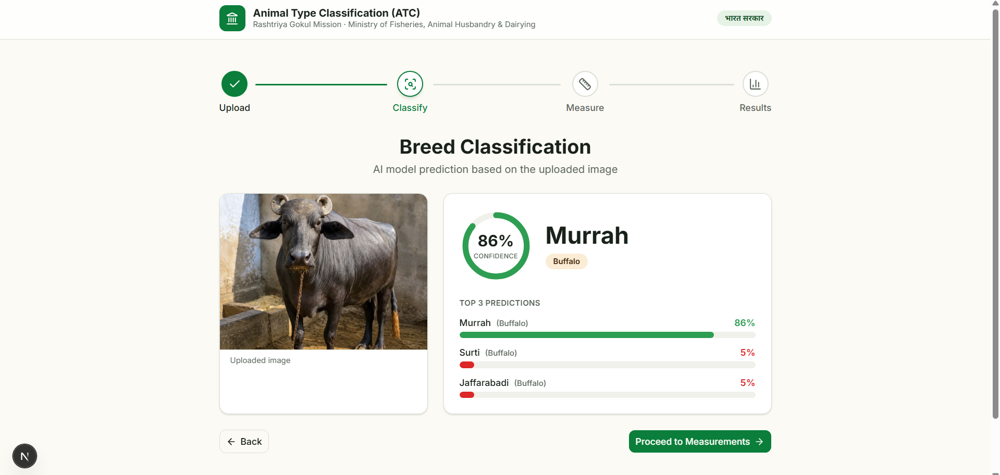
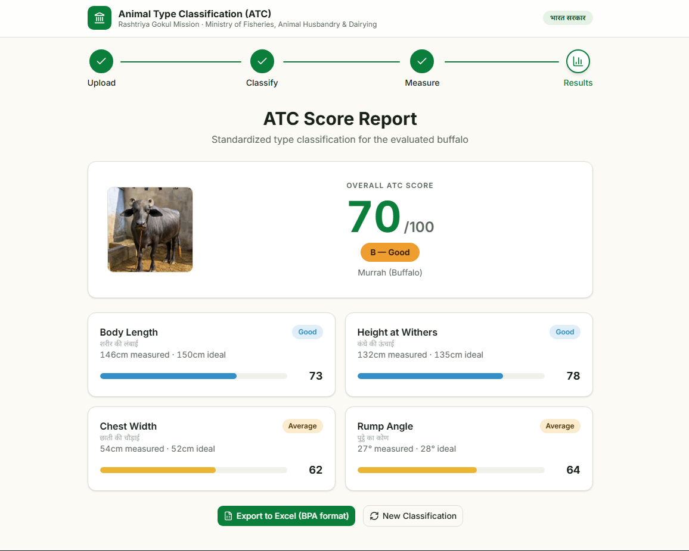

# Image-based Animal Type Classification for Cattle & Buffaloes

**SIH 2025 — Problem Statement ID: SIH25005**

[](https://vercel.com)
[](https://nextjs.org)
[](https://www.tensorflow.org/js)

## Problem

Manual ATC scoring by field workers under the Rashtriya Gokul Mission is:

- **Subjective and inconsistent** — manual scoring achieves only 65–70% accuracy, with results varying from worker to worker
- **Prone to human error** — fatigue and bias degrade data quality in breeding programs
- **Time-consuming** — the manual process consumes **40–60%** of field workers' time
- **Hard to standardize** — no unified digital record, difficult to integrate with the Bharat Pashudhan App (BPA)

## Features

- **AI breed identification** — Upload a photo of a cow or buffalo and a TensorFlow.js model identifies the breed from **8 Indian breeds** (Gir, Sahiwal, Kankrej, Ongole, Murrah, Surti, Jaffarabadi, Bhadawari) with confidence scores and top-3 predictions.
- **Fully client-side ML** — All inference runs in the browser via TensorFlow.js on the CPU backend. No server-side ML compute, no API costs, works offline after first load.
- **4-step guided wizard** — Upload → Classify → Measure → Score with a visual progress indicator.
- **Low-confidence guard** — Predictions below a 40% confidence threshold are flagged as unreliable, with warning banners shown to prevent incorrect scoring.
- **Body measurement sliders** — Adjust body length, height at withers, chest width, and rump angle within breed-specific ideal ranges (with ±10% tolerance), in bilingual (English/Hindi) labels.
- **Standardized ATC scoring** — A weighted 0–100 score with per-trait breakdown and A+/A/B+/B/C/D grades based on proximity to breed-specific RGM standards.
- **Excel export** — Generate a formatted `.xlsx` ATC report (SheetJS) ready for BPA (Bharat Pashudhan App) integration.
- **16 breed standards** — Scoring references the ideal body measurements for 10 cattle + 6 buffalo breeds defined per Rashtriya Gokul Mission guidelines.
- **RGM branding** — Header/footer with Rashtriya Gokul Mission identity.

## How it works

The app is a 4-step wizard that turns a single photo into a standardized ATC report:

```
Upload Image → AI Classify Breed → Enter Measurements → ATC Score + Export
```

1. **Upload** — Drag-drop or pick a photo of the animal. The image is validated and shown as a preview.
2. **Classify** — The image is resized to 224×224, normalized to [-1, 1], and passed through the MobileNetV2-derived TF.js model. The top-3 breed predictions with confidence percentages are shown, plus a warning banner if confidence falls below the 40% reliability threshold.
3. **Measure** — Guided sliders let the field worker record body length, height at withers, chest width, and rump angle. Slider ranges default to the breed's ideal values and tolerance.
4. **Score** — The ATC scoring engine computes a weighted composite score (0–100) with a per-trait breakdown and letter grade, then exports a `.xlsx` report.

## ML model details

- **Architecture:** MobileNetV2-derived (Keras Sequential → TF.js **LayersModel**), 224×224 RGB input, 8 output classes.
- **Preprocessing:** Resize to 224×224 → `toFloat()` → divide by 127.5 → subtract 1.0 (matches `mobilenet_v2.preprocess_input`, normalizes pixels to [-1, 1]).
- **Training:** Two-phase transfer learning — Phase 1 freezes the base (≈83% val accuracy), Phase 2 fine-tunes the top third (89.4% val accuracy, trained 2026-08-18).
- **Datasets:** ~7,400 images across 3 Kaggle datasets (CC0 / Apache 2.0), auto-downloaded via the Kaggle API.
- **Class labels:** `["Gir","Sahiwal","Kankrej","Ongole","Murrah","Surti","Jaffarabadi","Bhadawari"]`
- **Category mapping:** Cattle = Gir, Sahiwal, Kankrej, Ongole; Buffalo = Murrah, Surti, Jaffarabadi, Bhadawari.
- **Runtime:** CPU backend only (target field devices lack WebGL). Model is loaded lazily on first classification and cached for subsequent runs.
- **Reliability:** Predictions below 40% confidence are flagged `isReliable=false`; the UI then shows "unknown breed" warnings and falls back to mock predictions, which are always marked unreliable.
- **Known limitations:** Per-breed recall is weakest on Surti (63%) and Bhadawari (52%) — small training classes.

**Model files** (`public/models/`): `model.json` (Keras 2 schema), `group1-shard1of3.bin` / `shard2of3` / `shard3of3` (weights), `metadata.json` (labels).

| File | Size |
| --- | --- |
| `model.json` | 102 KB |
| `group1-shard1of3.bin` | 4.0 MB |
| `group1-shard2of3.bin` | 4.0 MB |
| `group1-shard3of3.bin` | 1.9 MB |
| `metadata.json` | 388 B |
| **Total** | **≈ 10 MB** (downloaded once, then cached by the browser) |

Since these are binary weights, the SHA-256 of a known-good export is worth keeping. Re-check after any
re-export (PowerShell `Get-FileHash <file> -Algorithm SHA256`, or `sha256sum <file>`):

| File | SHA-256 |
| --- | --- |
| `model.json` | `35C384B90B51F73784E9D839A492A1DBE74E10DE49B957B90E4D586471D50A6F` |
| `group1-shard1of3.bin` | `D1548347CCEC0C85AA4ECC28DAECBA2B4CC917A662415CB8A30927F3C0FE1B24` |
| `group1-shard2of3.bin` | `A703EC40742489F64B6EDC4BA23F1DA221CD3C35C135D00C452F3413166034E6` |
| `group1-shard3of3.bin` | `F2F6F9CE6A4F5F81DFC0899B28C0BC5C78290BF495843B5FAD73FC1FC92B6046` |
| `metadata.json` | `93841F1DB267789E5D76CE47975EBB1C1C1C244FB9039F88786B7E9270164B84` |

### Training data

Pulled automatically with the Kaggle API (`kaggle datasets download …`) — only the breed folders
that are needed are kept, not the full archives:

| Kaggle dataset | Contents | License |
| --- | --- | --- |
| `atharvadarpude/indian-cattle-image-dataset` | 50 Indian cattle breeds | CC0 |
| `atharvadarpude/indian-buffalo-dataset` | 17 Indian buffalo breeds | CC0 |
| `birendranathnandi/indian-cattle-and-buffalo-breeds-dataset` | Extra cattle & buffalo images | Apache 2.0 |

Only the 8 detectable breeds are extracted from these and split into train/val folders.

### Training scripts

| Script | Purpose |
|---|---|
| `colab_train.py` | 13-cell Google Colab notebook: install → download → train → export TF.js |
| `colab_run_all.py` | Single-cell all-in-one Colab runner |
| `train_local.py` | Standalone local GPU training (e.g. RTX 2000 Ada 24 GB), `--skip-download`/`--skip-phase1` resume flags |
| `fix_tfjs_model.py` | Converts Keras 3-format model.json to the Keras 2 schema tfjs 4.x can load (run after every export) |

## ATC scoring formula

The overall ATC score is a **weighted composite** of four body traits:

| Trait | Weight |
|---|---|
| Body Length | 30% |
| Height at Withers | 25% |
| Chest Width | 25% |
| Rump Angle | 20% |

Each trait is scored 0–100 from its deviation against the breed's ideal value within a tolerance window:

```
maxDeviation = ideal × (tolerance / 100)          // tolerance = 10% per RGM standards
deviation    = |measured − ideal|
traitScore   = max(0, 100 − (deviation / maxDeviation) × 100)   // clamped to [0, 100]

overallScore = Σ (traitScoreᵢ × weightᵢ)          // rounded to nearest integer
```

Trait status thresholds: **Excellent** ≥ 85, **Good** ≥ 70, **Average** ≥ 50, else **Poor**.

Overall letter grade:

| Score | Grade |
|---|---|
| ≥ 90 | A+ (Excellent) |
| ≥ 80 | A (Very Good) |
| ≥ 70 | B+ (Good) |
| ≥ 60 | B (Fair) |
| ≥ 50 | C (Average) |
| < 50 | D (Poor) |

Ideal measurements are defined per breed in `src/lib/breed-standards.ts` (10 cattle + 6 buffalo breeds).

## Excel report contents

`exportToExcel()` writes a single **ATC Report** sheet:

| Block | Fields |
| --- | --- |
| Header | Animal ID (or `N/A`), Breed, Category, Classification Confidence |
| Traits | Body Length (cm), Height at Withers (cm), Chest Width (cm), Rump Angle (deg) — each with its measured value, ideal value, 0–100 score and status |
| Footer | Overall ATC Score, Grade |

## Getting started + deployment

### Prerequisites

- Node.js 18+ and npm
- Python 3.10+ (only for model training, not required to run the app)

### Run locally

```bash
# Clone the repo
git clone https://github.com/FarhanFarooqui122/lmage-based-Animal-Type-Classification-for-cattle-and-buffaloes-SIH25005.git
cd lmage-based-Animal-Type-Classification-for-cattle-and-buffaloes-SIH25005

# Install dependencies
npm install

# Run development server
npm run dev
```

Open [http://localhost:3000](http://localhost:3000) in your browser.

### Scripts

| Command | What it does |
| --- | --- |
| `npm run dev` | Start the development server |
| `npm run build` | Production build (fails on TypeScript errors) |
| `npm run start` | Serve the production build |
| `npm run lint` | Run ESLint |

### Deploy to Vercel

```bash
npm run build
npx vercel deploy
```

All ML inference happens client-side (TensorFlow.js CPU backend), so no server-side ML compute or environment variables are needed. The app builds as a standard Next.js app (`output: "standalone"` in `next.config.ts`).

### (Optional) Retrain the model

1. Open `colab_train.py` and paste each cell into a Google Colab notebook (or paste the whole `colab_run_all.py` block).
2. Upload your Kaggle API key when prompted.
3. Run all cells — trains on 3 Kaggle datasets (~7,400 images, 8 breeds).
4. Final cells convert Keras `.h5` → TF.js LayersModel + `metadata.json`.
5. Run `python fix_tfjs_model.py` on the exported `model.json` (required for tfjs 4.x compatibility).
6. Copy the output into `public/models/`.

### What `fix_tfjs_model.py` changes

tensorflowjs_converter 4.x + Keras 3 emit a schema tfjs 4.22 cannot parse, so the script rewrites
`model.json` to the Keras 2 shape (idempotent, safe to re-run):

1. `InputLayer`: `batch_shape` → `batch_input_shape`
2. layer `dtype`: `DTypePolicy` object → plain `"float32"`
3. strips Keras 3 extras (`module`, `registered_name`)
4. `inbound_nodes`: `{args: …, kwargs: …}` → flat Keras 2 node arrays (flattens nesting for `Add`)
5. `model_config.class_name`: `Functional` → `Model`, wrapping flat `input_layers` / `output_layers`
   tuples into lists
6. `weightsManifest`: renames DepthwiseConv2D `kernel` → `depthwise_kernel`

For local GPU training instead: `pip install -r requirements-train.txt` then `python train_local.py --epochs 100`.

Local training keeps everything under `training/`:

| Path | Contents |
| --- | --- |
| `training/downloads/` | Raw Kaggle zips |
| `training/raw/` | Extracted breed folders |
| `training/data/train`, `training/data/val` | The split the model actually trains on (`--split`, default 0.8) |
| `training/output/` | Checkpoints and the exported TF.js model |

Flags: `--epochs` (default 100), `--batch-size` (64), `--split` (0.8), `--seed` (42), plus
`--skip-download` and `--skip-phase1` to resume an interrupted run. Copy `training/output/tfjs_model/*`
into `public/models/` when it finishes.

## Screenshots

| Step | Preview |
|---|---|
| Upload |  |
| Results |  |

A sample Gir cow photo is available at `public/images/sample-gir-cow.png` for quick testing of the upload step.

## Troubleshooting

| Symptom | Likely cause / fix |
| --- | --- |
| Model never loads, hangs or throws on first classification | A freshly exported `model.json` is in **Keras 3 schema**, which tfjs 4.x cannot load — run `python fix_tfjs_model.py` on it (idempotent) and redeploy |
| First classification feels slow | The ≈10 MB model is fetched lazily on first use and cached afterwards; later runs are fast |
| Predictions show "unknown breed" warnings | Top confidence is below the 40 % threshold (`CONFIDENCE_THRESHOLD` in `src/lib/atc-data.ts`), so the result is flagged unreliable and scoring shows a caution note |
| Works offline after the first visit | Inference is client-side only (TF.js CPU backend); only the initial model download needs the network |

## Roadmap

- [ ] Capture and add screenshots of the live wizard
- [ ] Integrate the generated ATC report directly into the **Bharat Pashudhan App (BPA)** API
- [ ] Add 8 more detectables to the model (Tharparkar, Red Sindhi, Hariana, Rathi, Khillari, Deoni, Banni, Mehsana, Nagpuri, Pandharpuri) — breed standards already defined
- [ ] Improve per-breed recall on small classes (Surti, Bhadawari) with data augmentation & class weighting
- [ ] Expand the model to detect all 16 breeds with standards
- [ ] Add Hindi (Hindi UI) full localization beyond measurement labels
- [ ] Offline-first mode (service worker caching of model weights for field use)
- [ ] Mobile camera capture with on-device image cropping/auto-centering
- [ ] Photogrammetry-assisted measurement entry to reduce manual slider input

## Tech Stack

| Layer | Technology |
|---|---|
| Framework | Next.js 16 (App Router) |
| ML Runtime | TensorFlow.js (client-side inference) |
| Model Training | MobileNetV2 (Keras) → TF.js LayersModel |
| UI | TailwindCSS + shadcn/ui |
| Excel Export | SheetJS (xlsx) |
| Deployment | Vercel (Next.js standalone build) |

## Supported Breeds

**Model detects (8):** Gir, Sahiwal, Kankrej, Ongole, Murrah, Surti, Jaffarabadi, Bhadawari

**Breed standards available (16):** All 8 detectables plus Tharparkar, Red Sindhi, Hariana, Rathi, Khillari, Deoni, Banni, Mehsana, Nagpuri, Pandharpuri

Ideal measurements for the 8 the model can actually detect (`src/lib/breed-standards.ts`, all with a
10 % tolerance window):

| Breed | Category | Body length | Height at withers | Chest width | Rump angle |
| --- | --- | --- | --- | --- | --- |
| Gir | Cattle | 155 cm | 135 cm | 48 cm | 25° |
| Sahiwal | Cattle | 140 cm | 125 cm | 45 cm | 24° |
| Kankrej | Cattle | 150 cm | 140 cm | 47 cm | 25° |
| Ongole | Cattle | 160 cm | 145 cm | 50 cm | 26° |
| Murrah | Buffalo | 150 cm | 135 cm | 52 cm | 28° |
| Surti | Buffalo | 140 cm | 128 cm | 48 cm | 27° |
| Jaffarabadi | Buffalo | 155 cm | 140 cm | 55 cm | 29° |
| Bhadawari | Buffalo | 130 cm | 120 cm | 44 cm | 26° |

## Project Structure

```
src/
├── app/                    # Next.js App Router pages
│   ├── page.tsx           # Home page
│   ├── layout.tsx         # Root layout
│   └── globals.css        # Tailwind v4 + shadcn theme
├── components/
│   ├── atc-wizard.tsx     # 4-step wizard state controller
│   ├── wizard-client.tsx  # Dynamic import wrapper (ssr:false)
│   ├── site-header.tsx    # Header & footer with RGM branding
│   ├── step-indicator.tsx # 4-step progress bar
│   ├── upload-step.tsx    # Step 0: drag-drop image upload
│   ├── classify-step.tsx  # Step 1: AI breed predictions
│   ├── measure-step.tsx   # Step 2: body measurement sliders
│   ├── results-step.tsx   # Step 3: ATC score + export
│   └── ui/                # shadcn/ui primitives
│       └── button.tsx     # @base-ui/react button
├── lib/
│   ├── atc-data.ts        # Integration bridge (TF.js + scoring + export)
│   ├── atc-scoring.ts     # Weighted ATC scoring algorithm
│   ├── breed-standards.ts # 16 breed standards data
│   ├── excel-export.ts    # XLSX generation (SheetJS)
│   ├── tfjs-loader.ts     # TF.js model loader + classify
│   └── utils.ts           # cn() helper
├── types/
│   └── index.ts           # Shared TypeScript interfaces
public/
├── models/                # TF.js model (model.json, group1-shard*.bin, metadata.json)
└── images/                # Sample images
```

## License

MIT